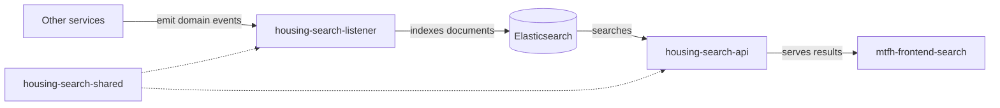

# Housing Search API

The Housing Search API is the London Borough of Hackney (LBH) **MTFH** service responsible for searching
for **persons, tenures, assets, accounts, transactions and processes**. It is a read-only,
Elasticsearch-backed search API: documents are indexed by the platform's other services and queried here.

## Tech stack

| Area | Technology |
| --- | --- |
| Runtime | **.NET 10** (`net10.0`), ASP.NET Core Web API |
| Hosting | **AWS Lambda** (`dotnet10` managed runtime) via `Amazon.Lambda.AspNetCoreServer`, in AWS region `eu-west-2` |
| API layer | Amazon **API Gateway** (`ANY /{proxy+}`) behind a request authorizer and the `Platform_APIs_Web_ACL` WAF |
| Datastore | **Elasticsearch** accessed with **NEST** (AWS-managed domain `housing-search-api-es`) |
| Infrastructure | **Terraform** (Elasticsearch domain, alarms) per environment under [`terraform/`](terraform) |
| Deployment | **Serverless Framework** ([`HousingSearchApi/serverless.yml`](HousingSearchApi/serverless.yml)) driven by **CircleCI** |
| Observability | **AWS X-Ray** tracing, `Hackney.Core.Logging` structured logging |
| API docs | **Swashbuckle** (Swagger/OpenAPI), one document per API version; the canonical definition is on [Swagger Hub](https://app.swaggerhub.com/apis/Hackney/housingSearchApi/1.0.0) |
| Cross-cutting | `Hackney.Core.*` packages (ElasticSearch, health checks, HTTP, JWT, logging, middleware, validation), FluentValidation for request validation, MVC API versioning (URL segment reader) with a V1/V2 split, `Newtonsoft.Json` as the MVC JSON formatter |
| Testing | xUnit (+ `TestStack.BDDfy` for the E2E stories), a few remaining NUnit-style fixtures, FluentAssertions, Moq |

## Endpoints

Versioning uses `UrlSegmentApiVersionReader` with `DefaultApiVersion = 1.0` and
`AssumeDefaultVersionWhenUnspecified = true`. Every V1 controller is decorated `[ApiVersion("1")]`,
`[ApiController]`, `[Produces("application/json")]`.

The V1 request models all derive from a common query base (`HousingSearchRequest`): `searchText`, `pageSize`
(default 12), `page`, `sortBy`, `isDesc`, `issimplequery`, `isFilteredQuery`.

| Verb | Route | Request (model) | Response (model) | Summary |
| --- | --- | --- | --- | --- |
| GET | `/api/v1/search/persons` | `GetPersonListRequest` (+ `personType`) | `200 OK` → `APIResponse<GetPersonListResponse>` — `results.persons[]`, `total` | Searches the `persons` index for people matching the search text, filtered by person type. |
| GET | `/api/v1/search/accounts` | `GetAccountListRequest` | `200 OK` → `APIResponse<GetAccountListResponse>` — `results.accounts[]`, `total` | Searches the `accounts` index for rent/account records matching the search text. |
| GET | `/api/v1/search/tenures` | `GetTenureListRequest` (+ `uprn`, `bookingStatus`, `isTemporaryAccommodation`) | `200 OK` → `APIResponse<GetTenureListResponse>` — `results.tenures[]`, `total` | Searches the `tenures` index, optionally narrowed by UPRN, booking status and temporary-accommodation flag. |
| GET | `/api/v1/search/tenures/all` | `GetAllTenureListRequest` (+ `uprn`, `bookingStatus`, `isTemporaryAccommodation`, `lastHitId`, `lastHitTenureStartDate`) | `200 OK` → `APIAllTenureResponse<GetAllTenureListResponse>` — `results[]`, `total`, `lastHitId`, `lastHitTenureStartDate` | Search-after paging over the whole `tenures` index (no result-count ceiling); only valid when sorting by `tenureStartDate`. |
| GET | `/api/v1/search/assets` | `GetAssetListRequest` (+ `assetTypes`, `numberOfBedrooms`, `isActive`, `useCustomSorting`) | `200 OK` → `APIResponse<GetAssetListResponse>` — `results.assets[]`, `total` | Searches the `assets` index. Returns `400` when `useCustomSorting=true` is combined with `page`/`sortBy`. |
| GET | `/api/v1/search/assets/all` | `GetAllAssetListRequest` (+ `lastHitId`, `assetStatus`, `numberOfBedSpaces`, `numberOfCots`, `floorNo`, `privateBathroom`, `privateKitchen`, `stepFree`, `contractApprovalStatus`, `contractApprovalStatusReason`, `contractIsActive`, `contractEndReason`, `chargesSubType`, `isTemporaryAccomodation`, `parentAssetId`, `tenureType`, `temporaryAccommodationParentAssetId`, `isPartOfTemporaryAccommodationBlock`) | `200 OK` → `APIAllResponse<GetAllAssetListResponse>` — `results[]`, `total`, `lastHitId` | Search-after paging over the whole `assets` index with the full set of asset filters. |
| GET | `/api/v1/search/assetrelationships` | `GetAssetRelationshipsRequest` (`searchText` is required) | `200 OK` → `GetAssetRelationshipsResponse` — `childAssets[]` (not wrapped) | Returns the child assets related to the search text; a blank `searchText` returns `400 "Request searchtext cannot be blank"`. |
| GET | `/api/v1/search/processes` | `GetProcessListRequest` (+ `targetType`, `targetId`, `isOpen`, `processNames`) | `200 OK` → `APIResponse<GetProcessListResponse>` — `results.processes[]`, `total` | Searches the `processes` index for process records, optionally filtered by target and open/closed state. |
| GET | `/api/v1/search/transactions` | `GetTransactionListRequest` (+ `startDate`, `endDate`) | `200 OK` → `APIResponse<GetTransactionListResponse>` — `results.transactions[]`, `results.total` | Searches the `transactions` index within the supplied date range. |
| GET | `/api/v2/search/{indexName}` | `SearchParametersDto` — `searchText` (default `""`), `pageSize` (default 120), `page` (default 1) | `200 OK` → `{ "results": { "<indexName>": [ ... ] }, "total": n }`; each document is a raw JSON object with an injected `confidenceScore` | Generic, untyped search: takes the index name from the URL and returns raw Elasticsearch documents rather than typed DTOs. |
| GET | `/api/v1/healthcheck/ping` | — | `200 OK` → health report written by `HealthCheckResponseWriter` | Unversioned liveness/readiness probe (mapped outside MVC). |
| GET | `/swagger` | — | OpenAPI document / Swagger UI | Interactive API documentation with one document per API version. |

Important characteristics:

- **V1** is the typed search API — one controller per search type under `V1/Controllers/`, each going through a
  use case to the search gateway and NEST. V1 is what `make test` covers.
- **V2** is a single generic `SearchController` (`V2/Controllers/SearchController.cs`) that takes the index
  name from the URL. V2 is covered by `make test-v2`.
- All endpoints are read-only and sit behind the API Gateway request authorizer and API key.

## Related repositories

This service is one of several repositories that make up the search capability. The listener keeps the
Elasticsearch indices up to date from domain events, the shared package holds the index and boundary models,
and the micro-frontend is the main consumer.

| Repository | Summary |
| --- | --- |
| [housing-search-api](https://github.com/LBHackney-IT/housing-search-api) | **Serves the search.** This repository — a read-only HTTP API over the Elasticsearch indices. |
| [housing-search-listener](https://github.com/LBHackney-IT/housing-search-listener) | **Maintains the indices.** An AWS Lambda that consumes domain events from the platform's services and indexes the corresponding documents in Elasticsearch. |
| [housing-search-shared](https://github.com/LBHackney-IT/housing-search-shared) | **Defines the search models.** The `Hackney.Shared.HousingSearch` NuGet package (index documents and boundary contracts) used by the API, the listener and their consumers. |
| [mtfh-frontend-search](https://github.com/LBHackney-IT/mtfh-frontend-search) | **Displays the results.** The MTFH search micro-frontend that calls this API to render person, tenure, asset and process search results. |

## Data sources and external dependencies

| Source | Summary |
| --- | --- |
| Elasticsearch indices | `persons`, `tenures`, `assets`, `accounts`, `transactions`, `processes` (see `V1/Infrastructure/IndexSelector.cs`). The only data store. |
| Index / mapping definitions | `*Index.json` files plus `seed-data.json` under [`HousingSearchApi/data/elasticsearch/`](HousingSearchApi/data/elasticsearch). Note there is no `accountsIndex.json`, and the test fixtures read these files from `./data/elasticsearch`. |
| AWS-managed Elasticsearch | Domain `housing-search-api-es`; the endpoint is published to SSM and injected as `ELASTICSEARCH_DOMAIN_URL`. Development/staging run `7.10`, production/pre-production run `7.8`. |
| Local Elasticsearch | `docker.elastic.co/elasticsearch/elasticsearch:7.9.3` with the `analysis-icu` plugin, plus Kibana 7.9.3, from [`docker-compose.yml`](docker-compose.yml). |
| Amazon API Gateway | Fronts the Lambda: `ANY /{proxy+}` and `GET /swagger/{proxy+}`, behind the request authorizer and the `Platform_APIs_Web_ACL` WAF. |
| AWS X-Ray | `AWSSDKHandler.RegisterXRayForAllServices()` + `app.UseXRay(...)`; the Lambda role has `AWSXRayDaemonWriteAccess`. |
| AWS SSM Parameter Store | `/housing-tl/{stage}/aspnetcore-environment`; per-stage Elasticsearch endpoint. |
| Postgres / DynamoDB | **Not used.** `database.env`, [`database/Makefile`](database/Makefile) and the DynamoDB settings in `appsettings*.json` are stale template leftovers, and `serverless.yml` carries an unimplemented TODO about a postgres mirror. |

## Contributing

Build, run, test and deployment instructions — including how to add a new search endpoint — live in
[CONTRIBUTION.md](CONTRIBUTION.md).

## Contacts

**Housing product team** — [mmh-project-team@hackney.gov.uk](mailto:mmh-project-team@hackney.gov.uk)
